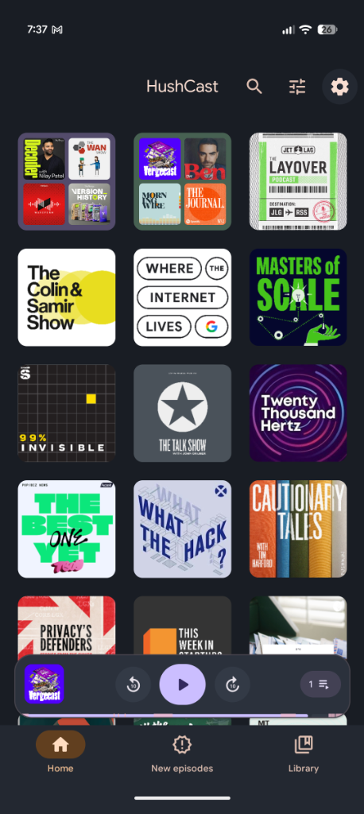
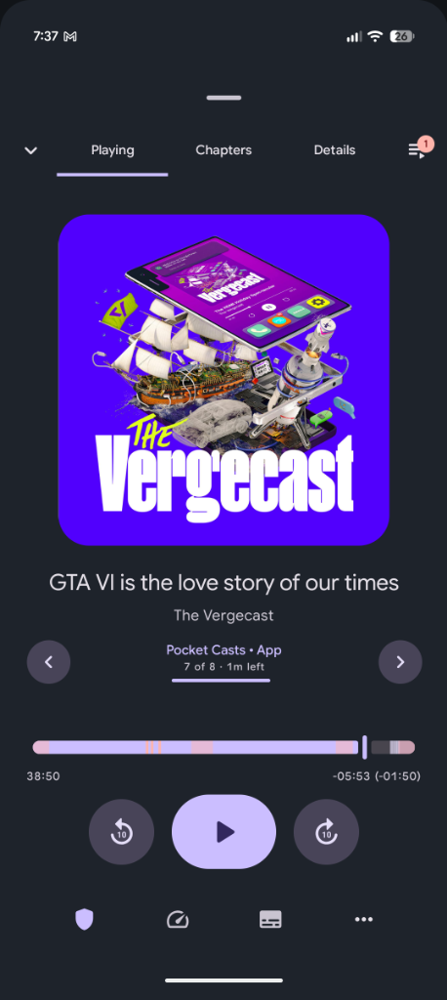
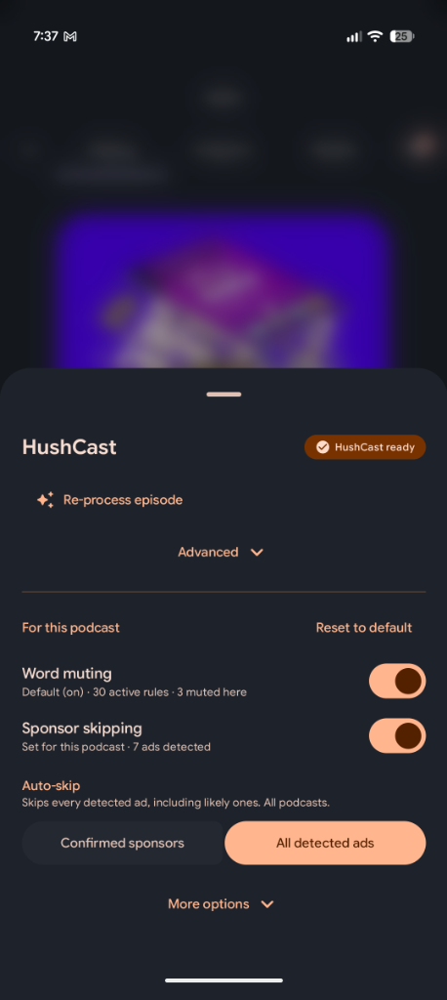
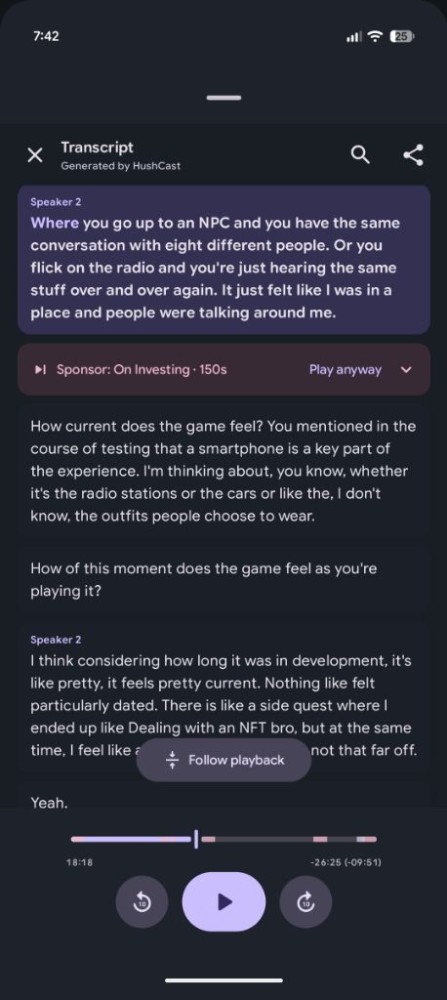
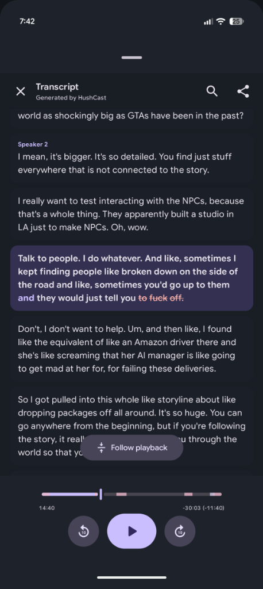
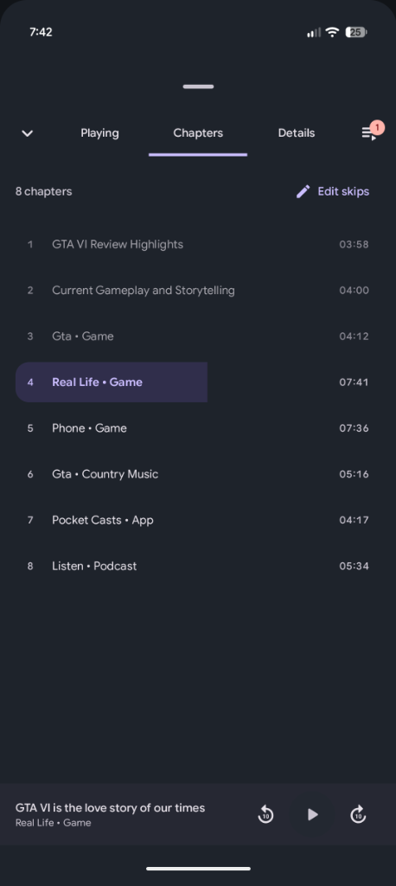

# HushCast

 

**HushCast** is a privacy-first, open-source podcast app for **Android** that automatically mutes or removes unwanted words and skips sponsor reads—using AI that runs **right on your phone**, on your **home Mac/PC**, or on your own **free-tier cloud GPU**.

> [!NOTE]
> **First-time setup on your phone:** After installing the APK, open **Settings → HushCast** to either download the on-device AI models over Wi-Fi **or** pair a Desktop/Cloud Companion Worker via QR code or local network discovery.

---

## 🌟 Why HushCast?

### 🔇 Mute, Duck, Bleep, or Snip Out Any Word
- **Five ways to handle matched words**:
  - **Hard Silence**: Cleanly mutes the word with smooth fade ramps.
  - **Volume Duck**: Lowers volume to 10% during the word.
  - **Micro-Skip**: Seamlessly splices the word out so you never hear a pause.
  - **Bleep**: Plays a classic censor tone.
  - **Custom Sound Effect**: Pick any audio file on your phone to play instead.
- **Presets & custom rules**: Built-in **Profanity** and **Explicit Content** presets, masked-word matching (`f***`, `s**t`), plurals, multi-word phrases, and custom rules.

### 📑 Auto-Generated Chapters, Transcripts & Summaries
- **Jump straight to the topics you care about**: When paired with a Desktop or Cloud Worker, HushCast automatically breaks episodes into timestamped **Chapters**—even for podcasts that don't include chapters in their feed.
- **Speaker-labeled transcripts & summaries**: Follow along with live-highlighted transcripts labeled by speaker (`Speaker 1`, `Speaker 2`, …), read AI-generated episode summaries, and search across analyzed episodes by meaning.

### ⏭️ Skip Sponsor Reads Automatically—With a Safety Net
- **Hands-free ad skipping**: HushCast detects host-read ads and sponsor segments and jumps right past them.
- **One-tap Undo & indicator chime**: Optionally play a subtle chime when a sponsor is skipped, and tap **Undo** in the player if you ever want to hear a segment back.
- **See what's coming**: Detected sponsor spans and muted words appear directly on the player scrubber and miniplayer progress bar, and collapse into neat pills in the transcript view.

### 🎧 A Fast, Tactile Podcast Player
- **Pocket Casts-style controls**: Compact floating miniplayer with queue count and blocked-content markers, plus a full-screen player with **Player**, **Transcript**, **Chapters**, and **Notes** tabs.
- **Effortless queue & episode management**: Swipe up for **Up Next** (with swipe-to-remove **Undo**), half-swipe episodes for quick actions, full-swipe for your primary action, or long-press to bulk-manage episodes.
- **Playback polish**: Speed stepper & presets (`0.5x`–`3.0x`) with live speed shown in Android's media notification, **Trim Silence**, **Volume Boost**, **speed- & skip-adjusted remaining time** (e.g., `-24:10 (-16:07)`), and a **10-second fade-out Sleep Timer**.
- **Adaptive Material 3 Expressive UI**: Artwork-adaptive **Material You** colors, smooth progressive-blurred podcast headers, predictive back gestures, and customizable player action buttons.
- **Bring your library with you**: Search via **Podcast Index** and **Apple Podcasts**, import `.opml` files (including folders) from Pocket Casts or other apps, start streaming immediately while downloading, sync via **gpodder.net** / **Nextcloud**, and listen in the car with **Android Auto**.

---

## ⚡ Choosing a Processing Method (Practical Comparison)

HushCast can analyze episodes in three ways. Switch anytime in **Settings → HushCast** (under **Automatic downloads**, pick **Auto** to prefer your paired worker and fall back to your phone, **On-device** to always use your phone, or **Skip** to download audio without analyzing).

| What matters to you | 📱 On-Device (Phone Only) | 🖥️ Desktop Worker (Your Mac / PC) | ☁️ Cloud Worker (Modal) |
| :--- | :--- | :--- | :--- |
| **Setup** | **Easiest.** Tap once in Settings to download ~455 MB of models. No computer or account needed. | **Moderate.** Run a small background app on your Mac or PC and scan a QR code. | **Most setup.** Requires a free Modal account and a one-time terminal deploy, then scan a QR code. |
| **Speed** | **Slowest** (~several minutes per hour of audio on phone CPU). | **Fast** (usually under a minute per episode on Apple Silicon or a desktop GPU). | **Fastest** once warm (tens of seconds on a cloud GPU; ~15–25s cold start if idle). |
| **Phone battery & heat** | **Uses noticeable battery** and warms the phone during analysis (best left for overnight charging). | **Zero battery impact** on your phone—your computer does all the work. | **Zero battery impact** on your phone—the cloud GPU does all the work. |
| **Word & ad accuracy** | **Good** for everyday English podcasts and sponsor skipping. | **Better / Best** (supports larger speech models and fewer missed words or cutoffs). | **Best** (uses the largest speech model by default). |
| **Extra AI perks** | Word muting, ad skipping, and searchable transcript. | Adds **speaker labels**, **auto-generated chapters**, **episode summaries**, and **search by meaning**. | Adds **speaker labels**, **auto-generated chapters**, **episode summaries**, and **search by meaning**. |
| **Offline & privacy** | **100% private & offline.** Audio never leaves your phone. | **100% private on your home network.** Works over Wi-Fi without external cloud servers. | **Private to your own Modal account**, but requires internet and sends episode URLs to your Modal server. |
| **Cost** | **Free.** | **Free** (uses your own computer). | **Free tier friendly** (uses Modal's ~$30/month free credit; scales to zero when idle). |

---

## 🧠 How the AI Engine Works (Technical Overview)

Under the hood, HushCast runs a two-stage pipeline so even mid-range phones stay within safe memory limits:

1. **Speech-to-Text & Word Alignment**
   - **Fast-path transcripts**: If a podcast provides Podcasting 2.0 JSON, SRT, or VTT transcripts, HushCast runs a 30-second audio spot-check to verify timing before skipping full transcription.
   - **On-device fallback**: Otherwise, `whisper.cpp` (with DTW word-level timestamps) and Silero VAD transcribe the audio into exact word start/end milliseconds.
   - **Real-time audio DSP**: During playback, a custom Media3 `AudioProcessor` applies 8ms cosine fade ramps (for Hard Silence / Duck / Bleep) or 12ms cosine crossfades (for Sample-Drop Micro-Skip) directly to the PCM audio stream.

2. **Ad & Sponsor Detection**
   - Once transcription finishes, Whisper is unloaded from RAM before loading `Qwen3-Embedding-0.6B` (`llama.cpp`) + `ad_tagger.onnx` sequentially. This detects host-read sponsor boundaries without spiking peak memory.

3. **Desktop / Cloud Companion Worker (`desktop-worker`)**
   - **Zero-Drift DAI Sync**: Dynamic Ad Insertion (DAI) shifts timestamps between downloads. To prevent drift, the worker downloads the episode first, runs `whisper.cpp` (`large-v3-turbo` or `base.en`) + `Qwen3-Embedding-0.6B` + `ad_tagger.onnx`, and serves **both the exact audio bytes and the analysis bundle** keyed by `fileSha256` to your phone.
   - **Speaker Diarization**: Acoustic MFCC + F0 pitch clustering labels speakers (`Speaker 1`, `Speaker 2`, …) in the synced transcript.
   - **Grounded Auto-Chapters & Summaries**: Embedding topic-shift boundaries lock chapters to exact transcript timestamps across the full episode, with TF-IDF or local LLM (`Qwen2.5-3B-Instruct-Q4_K_M.gguf`) titles and episode summaries.
   - **Discovery & Search**: Advertises `_hushcast._tcp.local.` over Bonjour/mDNS, prints a scannable `hushcast://pair?...` QR code, supports **Refresh on Desktop / Cloud** (`force=true`), cache cleanup (`--clear-cache` / `--clear-audio-cache` / `DELETE /v1/cache`), and semantic transcript search via `POST /v1/search`.

---

## 📦 Installation

### Android App
1. Go to the [**Releases**](https://github.com/emkay5771/HushCast/releases) page on GitHub.
2. Download the latest `HushCast-*.apk` on your Android phone (`arm64-v8a`, **Android 14+ / API 34+**).
3. Open the downloaded file and allow **Install unknown apps** if prompted.
4. Open **HushCast → Settings → HushCast** to download the on-device AI models or pair your Desktop/Cloud Companion Worker.

### Desktop / Cloud Companion Worker (Optional)
See [`desktop-worker/README.md`](desktop-worker/README.md) for macOS Apple Silicon Metal setup, cache CLI flags, and Modal serverless GPU deployment.

---

## 🛠️ Building from Source

Requires **JDK 17+** and **Android SDK 37** (`platforms;android-37.0`, `build-tools;37.0.0`, `ndk;27.2.12479018`, `cmake;3.22.1`).

1. Clone the repository:
   ```bash
   git clone https://github.com/emkay5771/HushCast.git
   cd HushCast
   ```
2. Create a `local.properties` file in the project root (already gitignored) with your Android SDK path and optional [Podcast Index](https://api.podcastindex.org/) API credentials:
   ```properties
   sdk.dir=/path/to/Android/Sdk
   PODCAST_INDEX_API_KEY=your_key_here
   PODCAST_INDEX_API_SECRET=your_secret_here
   ```
3. Run unit tests and build the debug APK:
   ```bash
   ./gradlew :core:automute-engine:testDebugUnitTest :app:testDebugUnitTest :app:assembleDebug
   ```
   The APK will be generated at `app/build/outputs/apk/debug/app-debug.apk`.

---

## 🙏 Attribution & License

- Built on [**podium**](https://github.com/aimok04/podium)
- Incorporates ideas and capabilities from [**AntennaPod**](https://github.com/AntennaPod/AntennaPod), [**podcast-ad-tagger**](https://github.com/Q726kbXuN/podcast-ad-tagger), [**whisper.cpp**](https://github.com/ggml-org/whisper.cpp), and [**llama.cpp**](https://github.com/ggml-org/llama.cpp)

Licensed under the [**GNU General Public License v3.0 or later**](/LICENSE).

---

## 📸 Screenshots

<p align="center">
  
  
  
  <br />
  
  
  
</p>
